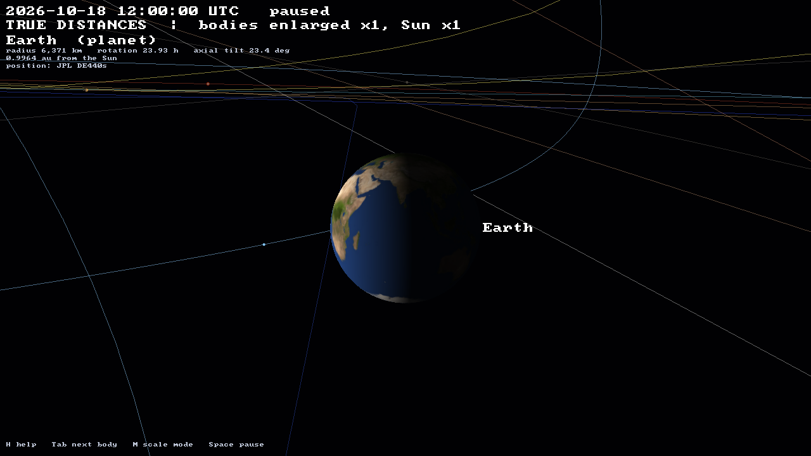
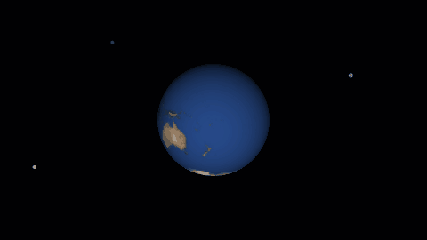
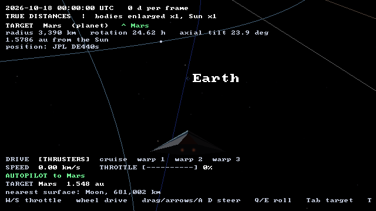
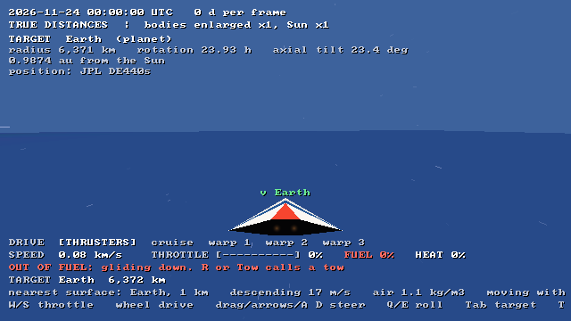
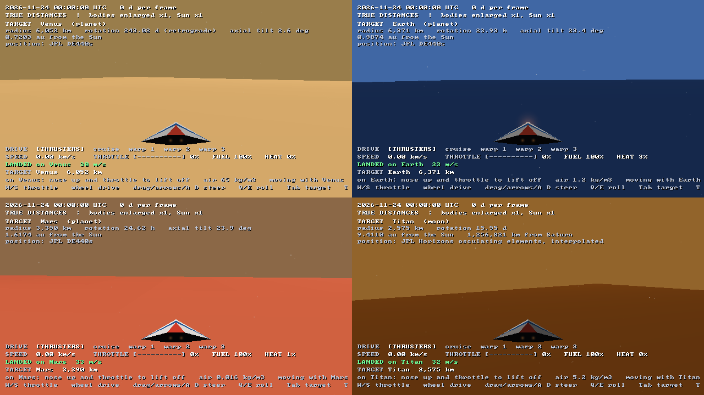
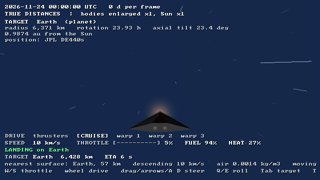
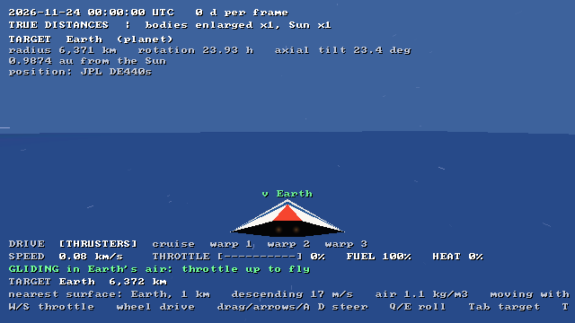
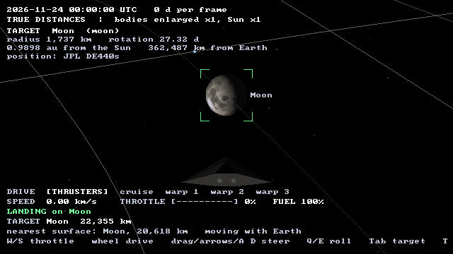
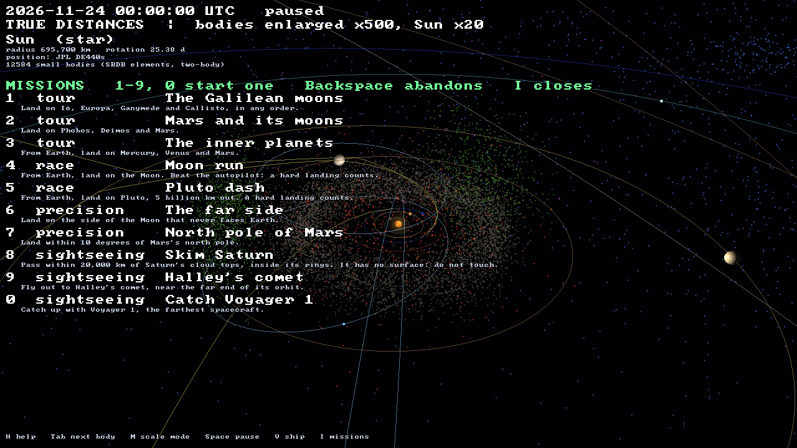
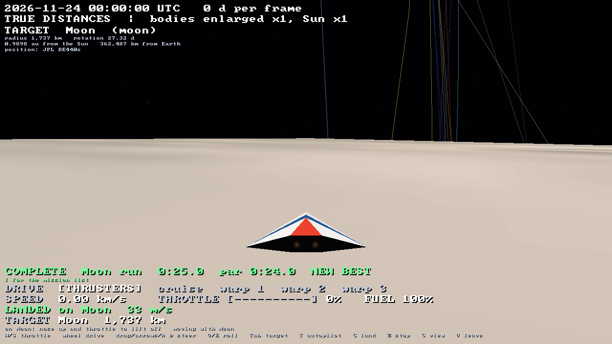

# orrery

The whole solar system from real JPL data, drawn with
[Strata](https://github.com/Preponderous-Software/strata):

- the Sun, the 8 planets and 5 dwarf planets.
- 25 moons: every moon with a mean radius of 100 km or more, plus Phobos and Deimos.
- Saturn's main rings at their measured radii.
- 12,584 asteroids, Jupiter trojans, centaurs and trans-Neptunian objects.
- three comets: Halley, Hale-Bopp and 67P.
- Voyager 1, Voyager 2 and New Horizons.

Bodies are placed from JPL ephemerides at any instant from 1850 to 2149.

**In a browser:** <https://orrery.play.danielstephenson.dev> (1980 to 2070;
drag to orbit, pinch or scroll to zoom; **Ship** to fly, with a thumb stick and a
throttle lever on a touch screen; **Missions** for timed goals). See [web/README.md](web/README.md).

<p align="center">
  
</p>

*2026 at **true distances**, with bodies enlarged ×500 and the Sun ×20 so they
can be seen. Each frame is 8 days. It was rendered headless by the real app:
`tools/make_media.py`.*

| Saturn, 2032 (true scale, ×1) | Jupiter and the Galilean moons (true scale, ×1) |
|---|---|
|  |  |
| **Pluto and Charon** (true scale, ×1) | **Everything, COMPRESSED (log) distances: NOT TO SCALE** |
|  |  |
| **Earth at 12:00 UTC, 18 October 2026** (true scale, ×1) | **Earth through 21 December 2026, an hour a frame** |
|  |  |

## Scale: what you are looking at

The real solar system cannot be shown at one scale. At true scale, Earth is
1/23,000 of its distance from the Sun, so at any zoom that shows several
orbits every planet is far smaller than a pixel. The orrery has two modes, and
the second line of the on-screen text always says which one is showing.

- **TRUE DISTANCES** (default): every position is the real one. Body radii are multiplied by a factor *k*, shown on screen as "bodies enlarged ×*k*, Sun ×min(*k*, 20)". The Sun is capped so it does not swallow Mercury.
  - Cycle *k* through 1, 10, 100, 500 and 2,000 with `[` and `]`.
  - At *k* = 1 everything is exactly to scale, and each body stays findable as a marker a few pixels wide.
  - Moons keep their true distances. At large *k* a moon can sit inside its enlarged planet: at ×500 the Moon is inside Earth. Use ×1 or ×10 to look at moon systems.
- **COMPRESSED (LOG) DISTANCES AND SIZES: NOT TO SCALE** (key `M`): every direction is kept, but distances and sizes are compressed.
  - Distance from the Sun becomes `5 au × log10(1 + r / 0.3 au)`.
  - Radii become proportional to √radius.
  - A moon at distance *d* from a planet of radius *R* is drawn at *R′*(1 + 2 log₁₀(*d*/*R*)), where *R′* is the planet's drawn radius.
  - Order is preserved: whatever is farther is drawn farther. The mode is for seeing the Kuiper belt and Mercury in one picture, never for judging distances.

## Building and running

**Downloads.** Releases made once `release.yml` is on `main` carry Windows x64 and Linux x64
downloads ([docs/RELEASING.md](docs/RELEASING.md)). They hold no JPL data: their `play-orrery`
script fetches it from JPL on the first run, so they need uv and the network then, too.

You need CMake 3.24 or newer, a C++17 compiler and OpenGL 4.5. Mesa's
llvmpipe is enough, so no GPU is needed. On Linux you also need the X11
development headers that SDL3 builds against (`libx11-dev libxext-dev
libxrandr-dev libxcursor-dev libxi-dev libxfixes-dev libxss-dev`). CMake
fetches Strata at the commit in [`strata.ref`](strata.ref).

The JPL data is not in the repository. On a fresh clone, download it from
JPL and build the catalogue once before anything else. This needs
[uv](https://docs.astral.sh/uv/) and the network; the scripts use only the
Python standard library.

```sh
uv run --python 3.12 tools/fetch_data.py all       # NAIF kernels (32 MB, SHA-256 checked) + ~66 JPL API requests, ~3 min
uv run --python 3.12 tools/build_catalog.py        # data/catalog/ for the app, tests/data/ for the tests
```

The download is rate limited and cached in `data/raw/`, so running it again
only fetches what is missing or whose query changed (`--refresh` fetches it
all again). `data/catalog/manifest.json` records what each build was made
from: every query, when it was fetched and the SHA-256 of each response.
[DATA_SOURCES.md](DATA_SOURCES.md) explains the pipeline and credits the
sources. Then build and run:

```sh
cmake -S . -B build -DCMAKE_BUILD_TYPE=Release
cmake --build build -j4
ctest --test-dir build --output-on-failure
./build/orrery                                      # a window at the current date and time
```

```sh
./build/orrery --date 1986-02-09 --focus Halley --enlarge 1                 # Halley at perihelion
./build/orrery --focus Saturn --enlarge 1 --distance-au 0.004              # Saturn's rings up close
./build/orrery --mode compressed --distance-au 30 --pitch 70              # the Kuiper belt from above
./build/orrery --headless --date 2026-10-18 --screenshot out.png          # one frame, no window
./build/orrery --headless --frames out/ --count 120 --step 3              # frames for a video
./build/orrery --date 2026-10-18 --export-usda solar-system.usda           # an OpenUSD layer
./build/orrery --focus Earth --enlarge 1 --ship --target Mars --autopilot   # fly from Earth to Mars
./build/orrery --focus Moon --enlarge 1 --ship --target Moon --land         # land on the Moon
./build/orrery --mission moon-run                                         # race to the Moon (I lists every mission)
```

The browser build (Emscripten, WebGL 2) is described in
[web/README.md](web/README.md).

Headless rendering uses an EGL surfaceless context, so it needs no X server.
On a machine with no GPU, set `LIBGL_ALWAYS_SOFTWARE=1 GALLIUM_DRIVER=llvmpipe`.
`orrery --help` lists every option.

## Controls

| Key | Action |
|---|---|
| `Space` | play / pause |
| `,` / `.` | slower / faster, from −1 yr/s through real time to +1 yr/s (negative runs backwards) |
| `N` | now, at real time |
| `J` | jump to a date: type `YYYY-MM-DD` or `YYYY-MM-DDTHH:MM` (UTC), then `Enter` |
| `Tab` / `Shift+Tab` | focus the next / previous body (every named body in turn) |
| `0`–`9` | Sun, Mercury … Neptune, Pluto |
| `Home` | the Sun |
| left-drag | orbit the focused body |
| wheel, `PgUp` / `PgDn` | zoom |
| `F` | free flight: `W A S D` to move, `Q` / `E` down / up, drag to look; `F` again to return to orbit |
| `V` | fly the ship ([below](#the-ship)); `V` again to return to orbit around its target |
| `I` | the [mission](#missions) list: `1`–`9`, `0`, `-` start one, `Backspace` abandons the current one, `I` or `Esc` closes it |
| `M` | TRUE / COMPRESSED scale |
| `[` / `]` | body enlargement in TRUE mode |
| `O` `L` `B` `X` | orbits, labels, small bodies, spin axes |
| `P` | screenshot (`orrery-NNN.png`) |
| `U` | export the current instant as `orrery.usda` |
| `H` | help |
| `Esc` | quit |

The text at the top left shows the following:

- the date and the time rate.
- the scale mode.
- facts about the focused body: radius, rotation period, axial tilt (from the IAU pole and the current orbit), distance from the Sun and from its parent, and where its position comes from.
- a warning when a body is outside its data, either extrapolated or with no trajectory at that date.

## The ship

<p align="center">
  
</p>

*On autopilot from near Earth to Mars at true scale, about 25 seconds of
flight: `--focus Earth --enlarge 1 --ship --target Mars --autopilot`.*

`V` puts you in a ship where the camera is, as in Rodina: one continuous
space from a moon's surface to the Kuiper belt, crossed by stepping the drive
up through speed tiers.

| Drive | Top speed | Earth to Mars (0.5 au) |
|---|---|---|
| thrusters | 2 km/s | 1 year |
| cruise | 200 km/s | 4 days |
| warp 1 | 1 c (299,792 km/s) | 4 minutes |
| warp 2 | 50 c | 5 seconds |
| warp 3 | 2,000 c | a moment; Neptune in 8 seconds |

- **Mass lock.** Heading toward a body, the drive covers at most 60% of the remaining distance to its surface each second. The ship slows down by itself on approach and never flies through a planet. The HUD names the body holding it back. Under any drive above thrusters, the lock brings the ship down onto a surface at a gentle 50 m/s. Thrusters are never locked, so on thrusters the landing is up to you.
- **Moving with a body.** Near a planet or moon, the ship moves with it as time runs, so a planet does not leave you behind at 30 km/s. The HUD shows which body you are moving with.
- **Size.** The ship is 1/100 of its altitude long, never under 10 m. It and its camera fit at every scale, from Phobos's surface to the outer planets. The space dust streaking past is sized the same way, so it always shows how fast you are moving relative to what is near.
- **The target** is the focused body: `Tab` and `0`–`9` choose it. Green brackets mark it, an arrow at the edge of the screen points to it when it is off screen, and the HUD gives its distance and an ETA at the current speed.
- **Autopilot** (`T`) turns the ship to the target, picks the drive and throttle, and stops a few radii out. From a surface it first climbs straight up. Any stick or throttle input takes back control.
- **Landing.** The speed into the surface at touchdown grades the landing: up to 120 m/s is a landing, up to 600 m/s a hard landing, and anything faster a crash. These are game thresholds; on thrusters a landing is under 6% throttle. A landed ship sits level and turns with the body as it rotates (from its IAU rotation elements). The throttle alone does not move it: pitch the nose up and throttle to lift off. A crash puts the ship back a quarter of a radius above the surface, at rest and pointing up. The Sun and the giant planets (Jupiter, Saturn, Uranus, Neptune) have no solid surface: their drawn radius is the IAU one, the 1 bar level in a giant's atmosphere. Reaching it at any speed burns the ship up in the Sun or loses it in a giant's clouds, and it is put back outside as after a crash. The HUD shows the climb or descent rate near a surface.
- **Landing autopilot** (`G`) flies to the target and sets down softly on it, climbing out first when it starts from another surface. With the Sun or a giant planet as the target, it stops at the plain autopilot's standoff instead.
- **Fuel.** The HUD shows FUEL. The drive burns it in proportion to the throttle, faster on a bigger drive. A full tank lasts about 17 minutes on thrusters at full, 8 on cruise and 2 at warp 3. Gliding and sitting on a surface burn none, and a landed ship refuels from empty to full in 5 seconds.
  - On an empty tank the throttle drops to zero and the autopilots stop, so the ship coasts to rest, or glides down if it is in air. `R` (the browser's **Tow** button, shown only then) calls a tow back to the standoff from the body you last landed on (else the nearest), with a full tank.
  - A mission starts with a full tank, and a tow abandons it. The rates and the refuelling are game values. `--fuel F` starts with that fraction of a tank.

<p align="center">
  
</p>

*An empty tank 1 km over Earth: the ship glides down, and the HUD offers the
tow: `--date 2026-11-24 --enlarge 1 --ship --target Earth --altitude 1 --fuel 0`.*
- **Air.** Venus, Earth, Mars and Titan have air, and Pluto and Triton a thin one. It thickens toward the ground, from the real surface density and scale height of each body ([DATA_SOURCES.md](DATA_SOURCES.md#air)). Pluto's and Triton's air is about a hundred-thousandth of Earth's: it barely heats or slows the ship, and their sky stays nearly black.
  - Air slows the ship. Venus's air is so thick that thrusters at full make well under 1 km/s near the ground.
  - Speed in air heats the ship, and the HUD shows HEAT. Each air has a burn speed, which is higher where the air is thinner: in Earth's air about 5 km/s at sea level, 16 km/s at 60 km and 50 km/s at the top (119 km). Heat climbs over a few seconds toward (speed / burn speed)³ and cools the same way. At 100% the ship burns up and is put back above the air, as after a crash. Above 75% the HUD warns HOT.
  - So come down on thrusters, or throttle well back on cruise. Mass lock alone lets the ship into Earth's air at about 70 km/s, which burns it up within a second.
  - Both autopilots keep to 60% of the burn speed in air (about 25% heat) and slow down before reaching the air's top. The landing autopilot reaches the ground in about 30 s on Earth, 20 s on Mars, 60 s on Titan and 90 s on Venus, all from its standoff.
  - Inside the air, the sky takes the air's colour on the day side, brighter the deeper you are. As it brightens, the faint things fade out: orbit lines, small bodies, the markers of distant bodies and the labels. They are gone by 40% daylight, about 15 km up on Earth. The Sun, the target and nearby bodies stay. A glow of hot air grows over the ship's leading end as it heats.
  - **Gliding.** In air at zero throttle and off autopilot, the ship glides instead of stopping, and the HUD says GLIDING. It flies at the speed at which its wings hold its weight, √(2gW/ρ) with a wing loading W of 400 kg/m², but never faster than the autopilots' cool speed. It sinks at a fifth of that speed. Steer it to where you want to land. Near Earth's ground that is about 80 m/s, sinking at 16 m/s, a soft landing. Mars's thin air makes a glide fast (about 430 m/s at the ground, still soft) and Pluto's makes it a hard landing. Venus's and Titan's thick air make it a slow drift. Throttle up to fly again.
  - The burn speed, the drag's ballistic coefficient (10,000 kg/m²), the wing loading, the glide ratio of 5, the single-layer air and the sky colours are game choices. The densities and scale heights are real, and the gravity comes from each body's GM and radius.

| Landed under four skies: Venus, Earth, Mars and Titan | Coming down into Earth's air: 57 km up, 10 km/s, 27% heat |
|---|---|
|  |  |

*The landing autopilot's last frame on each body, and frame 1000 of the
descent to Earth: `--date 2026-11-24 --enlarge 1 --ship --target Earth --land`.*

<p align="center">
  
</p>

*Gliding at zero throttle 1 km over Earth, ten seconds in: `--date 2026-11-24
--enlarge 1 --ship --target Earth --altitude 1`. `--altitude KM` starts the ship
that many kilometres above the target's surface, under the Sun, flying level.*

<p align="center">
  
</p>

*The landing autopilot from 20,000 km out to the Moon's surface, about 20
seconds of flight: `--date 2026-11-24 --focus Moon --enlarge 1 --ship --target Moon --land`.*

- In TRUE mode, speeds and distances are real (the drawn kilometres are kilometres). In COMPRESSED mode they are of the compressed drawing, and the HUD says so. Time keeps running at the chosen rate; `Space` pauses it while you keep flying.

| Key | Action |
|---|---|
| `W` / `S` | throttle up / down (down past zero is reverse, up to 25%) |
| wheel, `PgUp` / `PgDn` | drive tier up / down |
| left-drag, arrows, `A` / `D` | pitch and yaw |
| `Q` / `E` | roll left / right |
| `Tab`, `0`–`9`, `Home` | choose the target |
| `T` | autopilot to the target, on / off |
| `G` | land on the target, on / off |
| `Z` | all stop |
| `R` | out of fuel: call a tow |
| `C` | chase camera / cockpit |
| `V` | leave the ship |

In the browser, the toolbar's **Ship** button boards the ship. On a touch screen, a thumb stick steers, a throttle lever sets the throttle, and buttons do the rest. On a desktop they are hidden unless the **Joystick** toggle is on ([web/README.md](web/README.md)).

## Missions

| The mission list (`I`) | The Moon run, finished on the landing autopilot |
|---|---|
|  |  |

Eleven short goals for the ship, each timed. `I` lists them (the toolbar's
**Missions** button in the browser), and a number starts one: the ship is put
at the autopilot's standoff from the start body, facing the first goal, which
becomes the target. When a goal is done, the target moves on to the next one.

| | Kind | Mission | Goal |
|---|---|---|---|
| 1 | tour | The Galilean moons | land on Io, Europa, Ganymede and Callisto, in any order |
| 2 | tour | Mars and its moons | land on Phobos, Deimos and Mars |
| 3 | tour | The inner planets | from Earth, land on Mercury, Venus and Mars |
| 4 | race | Moon run | from Earth, land on the Moon; par 0:24.0 |
| 5 | race | Pluto dash | from Earth, land on Pluto; par 0:45.0 |
| 6 | precision | The far side | land on the Moon more than 120° from the point under Earth |
| 7 | precision | North pole of Mars | land at latitude 80° N or more on Mars |
| 8 | sightseeing | Skim Saturn | pass within 20,000 km of Saturn's cloud tops, without touching them |
| 9 | sightseeing | Halley's comet | pass within 10,000 km of Halley |
| 0 | sightseeing | Catch Voyager 1 | pass within 10,000 km of Voyager 1 |
| - | race | Hot entry | from the Moon, land on Earth through its air; par 0:30.0 |

- **Fair times.** A mission sets its own date (2026-11-24 for all eleven), TRUE scale and bodies at their real size, and runs time at real time, so times on one mission compare. Changing the scale, the enlargement or the date abandons it. The clock counts the seconds flown in the ship.
- **Landings** count when they are soft or hard; a crash, or reaching the Sun or a giant planet, does not. Precision landings count only where they ask, and the HUD says where the ship came down when it misses.
- **Races.** Mass lock caps everyone's approach the same way, and the landing autopilot flies close to that cap: 24.97 s to the Moon and 46.07 s to Pluto. Par is a second under that. The time is won at the end: under mass lock to within about a kilometre, then thrusters at about 30%, where a hard landing counts. `test_missions` flies that by hand and beats the autopilot by 1.8 s.
- **Hot entry** is a race through air. The landing autopilot keeps to 60% of the burn speed and takes 32.50 s; par is 30. Ride the heat higher by hand to beat it. In `test_atmosphere`, 80% of the burn speed (heat up to 65%) lands in 29.1 s, 90% (92%) in 28.1 s, and 95% burns up.
- **Flybys** are measured between steps, so a pass at warp 3, which can cover millions of kilometres in a frame, still counts.
- **Best times** are kept per device: in the browser's `localStorage`, and on the desktop in `records.txt` under `$XDG_DATA_HOME/orrery` (or `~/.local/share/orrery`; `%APPDATA%\orrery` on Windows; `$ORRERY_RECORDS` overrides it). Headless runs never read or write them, and neither does a run a test harness drives through Strata's drive channel (`STRATA_DRIVE`; Strata `docs/DRIVE.md`, playtester's `orrery-strata` profile), which takes its frame time from `engine.frameSeconds()` so a stepped harness gets the same frames on every run.

## What is drawn, and from what

| Class | Count | Position source |
|---|---|---|
| Sun, 8 planets, Pluto | 10 | JPL **DE440s** (read directly from the SPK file). Mars to Pluto come from their system barycentres, moved to the planet's centre by subtracting the catalogued moons' GM-weighted offsets |
| The Moon | 1 | DE440s |
| Moons with radius ≥ 100 km, plus Phobos and Deimos | 24 | JPL **Horizons** osculating elements relative to the planet's centre, every 30 days for 1980–2070, interpolated (below) |
| Ceres, Eris, Haumea, Makemake | 4 | Horizons heliocentric elements, every 30 days for 1850–2150, interpolated |
| Comets: 1P/Halley, C/1995 O1 (Hale-Bopp), 67P | 3 | Horizons heliocentric elements, every 60 days for 1850–2150, interpolated |
| Voyager 1, Voyager 2, New Horizons | 3 | Horizons state vectors every 10 days, cubic Hermite interpolation; trajectory drawn up to the current date |
| Main-belt asteroids (numbered, H < 13) | 6,061 | JPL **SBDB** elements at one epoch, propagated two-body (Kepler) |
| Jupiter trojans (numbered, H < 13) | 1,558 | SBDB, two-body |
| Near-Earth asteroids (numbered, H < 17) | 436 | SBDB, two-body |
| Centaurs (orbit condition code ≤ 5) | 671 | SBDB, two-body |
| Trans-Neptunian objects: Kuiper belt and scattered disc (condition code ≤ 5) | 3,858 | SBDB, two-body |
| Saturn's D, C, B, A and F rings; Uranus's ε ring | 6 | NSSDCA ring radii, in the equatorial plane given by the IAU pole |

Further details:

- **Radii, poles and rotation periods** are the IAU WGCCRE 2015 values from NAIF's `pck00011.tpc`. Bodies are drawn as equal-volume spheres. The radii of Eris, Haumea and Makemake come from stellar-occultation papers.
- **Surfaces and rotation:** the Sun, the eight planets and the Moon carry planet maps (Solar System Scope, CC BY 4.0; artistic composites based on NASA data, see [DATA_SOURCES.md](DATA_SOURCES.md#planet-maps)). Each map turns about the body's IAU pole at its IAU sidereal rate, so axial tilt and the time of day on Earth are real. Every other body is a plain hand-picked tint.
- **Orbits** are drawn as the current osculating ellipse of each planet, dwarf planet and comet. The focused planet's moons get their ellipses too.
- **Lighting:** the Sun is the only light, a point light at its position. Night sides are dark except for a faint ambient term.
- **Interpolating element tables:** between two samples, *a*, *e* and *i* are linear, the node and periapsis follow the shorter arc, and the mean longitude is unwrapped by the revolution count the first sample's mean motion predicts. Positions are therefore exact at every sample and follow the real mean motion in between. A single osculating set would drift by tens of degrees a month for Phobos.

Every source, licence and citation is in [DATA_SOURCES.md](DATA_SOURCES.md).

## Accuracy

`tests/test_ephemeris.cpp` compares the orrery with reference state vectors
fetched from JPL Horizons at build time. Every check has a fixed tolerance,
so it holds for any later fetch, even as JPL updates its orbit solutions.
The values below are from a build with data fetched on 2026-10-18.

| Check | Epochs | Worst error | Tolerance |
|---|---|---|---|
| Sun, Mercury, Venus, Earth, Mars–Pluto barycentres (our SPK reader on DE440s vs Horizons on DE441), SSB-relative | 1950, 2000, 2026, 2100 | < 0.001 km | 2–50 km |
| Moon, geocentric | same | 0.010 km | 1 km |
| Jupiter's centre (barycentre minus the Galilean moons' pull) | 2003, 2026, 2049 | 0.09 km | 25 km |
| Pluto's centre (barycentre minus Charon's pull) | same | 4.8 km | 25 km |
| Phobos / Triton / Charon (interpolated element tables) | same | 9.5 / 17 / 0.02 km | 15 / 30 / 15 km |
| Io / Titan / Hyperion | same | 644 / 185 / 2,936 km | 1,000 / 300 / 5,000 km |
| Ceres / Eris (heliocentric tables) | same | 1,611 / 318 km | 5,000 km |
| 1P/Halley | 1986 perihelion, 2026, 2061 perihelion | 6,558 km | 20,000 km |
| Voyager 1 (Hermite on 10-day vectors) | 1989, 2012, 2026 | 0.05 km | 50 km |
| Vesta, two-body from SBDB elements: at the epoch / +1 yr / −10 yr | 2026-06-09 ± | 0.2 / 42,246 / 1,351,693 km | 1e3 / 1e5 / 3e6 km |

For scale:

- 644 km at Io is 0.09° of its orbit.
- 6,558 km at Halley's perihelion is 0.00004 au.
- The Vesta figures show the main limit of the small-body sample. Two-body orbits from a 2026 epoch drift by about 0.0003 au a year, and by about 0.01 au after a decade. That is invisible at belt scale, but these are not precise positions far from 2026.

The other tests:

- `test_kepler` covers Kepler's equation (elliptic and hyperbolic) to 1e-12, circular and eccentric orbits (by mean and by eccentric anomaly), the state ↔ elements round trip, and table interpolation that is exact against a synthetic Phobos-like orbit.
- `test_element_table` covers the moon and dwarf-planet element tables: loading a catalogue CSV by column name and sorting it by epoch, the error for a table with no rows, linear a, e and i between samples, node and argument of periapsis taking the shorter arc across 0/360, the mean longitude unwrapped by the whole turns the first sample predicts, and two-body propagation (flagged as extrapolated) before the first sample, after the last and around a single sample.
- `test_time` covers Julian Dates, leap seconds and TDB − UTC, and ISO parsing.
- `test_scale` checks that TRUE mode leaves positions untouched and multiplies radii by exactly the stated factor, and that COMPRESSED mode keeps direction and order. It also checks unit conversions (au, obliquity).
- `test_rotation` checks the body frames built from the IAU rotation elements: each frame is right-handed and orthonormal with +Z on the pole, W = 0 puts the prime meridian on the ascending node, and Earth's pole is 23.44° from ecliptic north with its prime meridian back in place after one sidereal day.
- `test_csv` covers the catalogue's CSV reader: comment and blank lines, CRLF line ends, empty cells, the fallback for an empty number, and errors that name the file for a ragged row, a missing header, an unknown column or a cell that is not a number.
- `test_flight` covers the ship: the drive tiers (warp 1 is the speed of light) and spooling up to warp 3, the controls (tier and throttle limits, reverse, all stop, and autopilot needing a present target and giving way to the stick), mass lock bringing a ship flown at Earth at warp down to a soft landing, the three touchdown grades on thrusters (a landed ship sits level; a crash is put back above the surface), the Sun and the giant planets having no surface to land on (lost at any speed; the landing autopilot stops at the standoff), lifting off only with the nose up, a landed ship turning with its body, the landing autopilot setting down on the Moon and climbing out from it, moving with a body inside its influence, steering that keeps the ship's axes orthonormal, autopilot arriving at its standoff from Mars, and the ship's size following its altitude.
- `test_missions` covers the missions: the list (ten, unique ids, every kind, pars on the races only), every mission's bodies existing and present at its date in the real catalogue with its landings on solid ground, the start pose, a landing tour completing in any order with a crash not counting and the clock stopping at the end, latitude and far-side landings counting only where they ask (and saying why not), a flyby at warp 3 counting across a single step, a race flown by hand beating the landing autopilot, and the best-time records (round trip, damaged lines skipped, only a faster time replacing one).
- `test_fuel` covers fuel: each tier's burn at full, half and reverse throttle, none at zero throttle, an empty tank dropping the throttle and refusing the autopilot, a glide on an empty tank still landing softly, refuelling on a surface from empty to full in 5 s, and the tow (back to the standoff of the body last landed on, facing it, at rest with a full tank, keeping the target; the nearest body when the ship never landed).
- `glide_to_earth` glides at zero throttle from 500 m over Earth headless in the app and checks for a soft touchdown.
- `mission_moon_run` and `mission_hot_entry` fly the Moon run and the hot entry headless in the app on the landing autopilot and check that they complete.
- `test_atmosphere` covers air: the four thick atmospheres and Pluto's and Triton's thin ones (none on the Sun, Mercury, the Moon or the giants), density at the surface, one scale height up and the top, and the burn speed. In flight it covers thrusters staying cool at 60 km in Earth's air, cruise at 40 km/s there burning up (put back above the air, cold and at rest), heat building over seconds just over the burn speed, Venus's air holding the ship back, the landing autopilot coming down through each of the four airs without passing 50% heat, climbing out on autopilot staying cool, the same burn-up at 500 times the drawn size, gliding at zero throttle (still flying, sinking, landing softly on Earth; no glide under power or without a known gravity), and the hot entry ridden by hand beating the landing autopilot by more than 3 s while 95% of the burn speed burns up.
- `land_through_air` flies the landing autopilot to Earth headless in the app and checks for a soft touchdown with the heat under 50%, and for no labels in the daytime sky once landed (Mercury and Venus are in view).
- `render_smoke` renders four views headless (three orbit views and one from the ship) and checks that each frame is lit, with the expected numbers of spheres, points, orbit vertices and labels, and that the ship is drawn in the ship view.
- CI also opens the exported USD layer with OpenUSD (`tests/check_usda.py`).
- The browser build's CI checks that the DE440s kernel cut for the web gives the same positions as the full kernel, bit for bit (`tests/check_trim_spk.py`; see [web/README.md](web/README.md)).

## Engine features this needed

Four generic features were added to Strata for this project in
[Strata #11](https://github.com/Preponderous-Software/strata/pull/11) (ABI 1.5):

- unlit **lines** (orbits).
- **points** with a pixel and/or world size. These draw 12,584 small bodies in one call, the Sun's disc and glow, and the markers that keep sub-pixel bodies visible.
- screen-space **text** in a public-domain 8×8 font (labels and HUD).
- a **space lighting** mode lit only by point lights.

The rings use Strata's static meshes (ABI 1.4). The planet maps use Strata's
textures and per-mesh model matrices
([Strata #16](https://github.com/Preponderous-Software/strata/pull/16), ABI 1.7):
each mapped body is one textured sphere mesh built once, and every frame only
its model matrix changes (pole, prime meridian, drawn radius and position
relative to the eye). The Sun's sphere is unlit. The browser build uses Strata's WebGL 2 device and
Emscripten build
([Strata #18](https://github.com/Preponderous-Software/strata/pull/18)).

**Precision** is handled in the orrery, not in Strata:

- Every position is a double in km.
- Each frame subtracts the camera position before converting to float (a floating origin), so floats only ever hold distances relative to the eye.
- The near plane follows the closest surface. Lines and points use depth clamp, so the far plane never cuts them.

## OpenUSD

`--export-usda` (or `U` in the window) writes the current instant as a USD
text layer:

- one `Sphere` per body, at true position and radius, in km in the J2000 ecliptic frame with `upAxis = "Z"`.
- one `Points` prim per small-body group.
- `customData` on each prim naming its data sources.

The layer is plain text written by the app. Strata's optional `modules/usd`
was not used because it needs a full OpenUSD build, which this program does
not otherwise need. The layer is meant for the other USD tools, which can open
it directly; CI checks it with OpenUSD (`usd-core`).

## Known gaps

- **Maps for ten bodies only.**
  - The Sun, the planets and the Moon have maps. These are artistic composites, not measured imagery (see [DATA_SOURCES.md](DATA_SOURCES.md#planet-maps)).
  - Other moons, the dwarf planets, comets and spacecraft are hand-picked tints, not measured data, and they do not visibly rotate.
  - Rotation uses the secular IAU terms only (no nutation or libration series), and gas-giant maps turn with System III rather than with their clouds.
- **Spheres only.** Bodies are equal-volume spheres. Jupiter's and Saturn's oblateness and Haumea's elongated shape are not drawn. Strata's mesh transforms could now flatten a sphere along its pole; that has not been done.
- **Missing moons.** Moons of dwarf planets other than Charon (Dysnomia, Hiʻiaka, Namaka, MK2) are not included: Horizons has no ephemeris for them. Moons smaller than 100 km (Amalthea, Janus, Larissa and many more) are left out by the size cutoff.
- **Limited time ranges.**
  - The time range is DE440s's coverage, 1849-12-26 to 2150-01-22.
  - Moon tables cover 1980–2070. Outside that span a moon is propagated two-body from the nearest sample and the HUD says "extrapolated".
  - New Horizons' trajectory file ends in 2050.
- **Geometric positions.** There is no light-time correction or aberration, so these are where bodies are, not where they appear from Earth. There are no eclipses and no shadows: Strata's point-light shadows are not used.
- **Two-body small bodies.** Small bodies are propagated two-body from a single 2026 epoch (see Accuracy).
- **UTC before 1972** uses TAI − UTC = 10 s, which is an approximation.
- **Plain labels.** Labels are skipped where they would overlap, and the font is ASCII only.
- **An arcade ship.** The ship's velocity follows its nose; there is no gravity, orbit or inertia. It stops and lands at the surfaces of the rocky planets, moons and dwarf planets, and flies through asteroids, comets and spacecraft. The Sun and the giant planets are a hard boundary at their drawn radius: there is no atmosphere to fly into, only being put back outside. Air is a single exponential layer with no winds, weather or real heat-shield physics; lift exists only as gliding at zero throttle. Autopilot flies straight at the target and does not steer around a body in the way: mass lock slows it, and it lands on that body.
- **Mission times stay on the device.** There is no shared leaderboard, and a desktop and a browser keep separate records.
- **Depth precision.** A deep near-to-far range is unavoidable. Far spheres can fall beyond the far plane, but their point markers still show them.

## Licence

MIT; see [LICENSE](LICENSE). The data is not the code's: see
[DATA_SOURCES.md](DATA_SOURCES.md) for its terms. The planet maps in
`data/textures/` are © Solar System Scope (www.solarsystemscope.com), CC BY
4.0; `third_party/stb/stb_image.h` is public domain.
