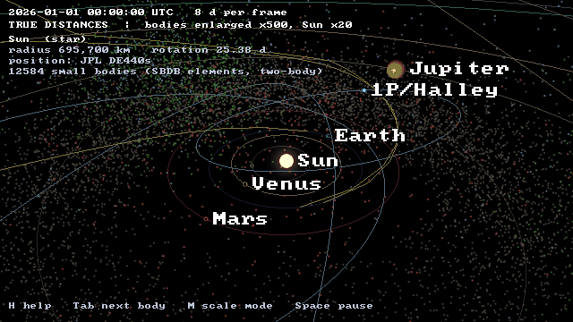
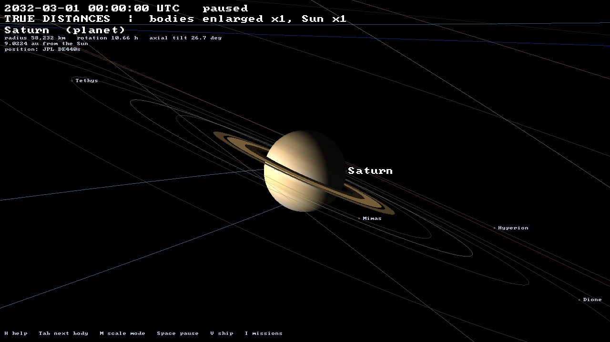
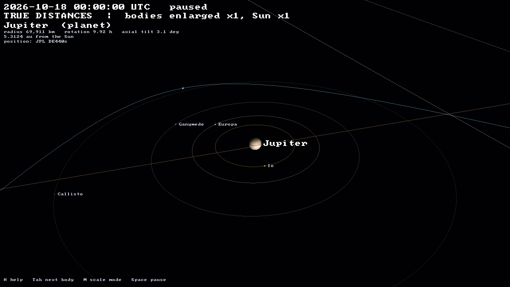
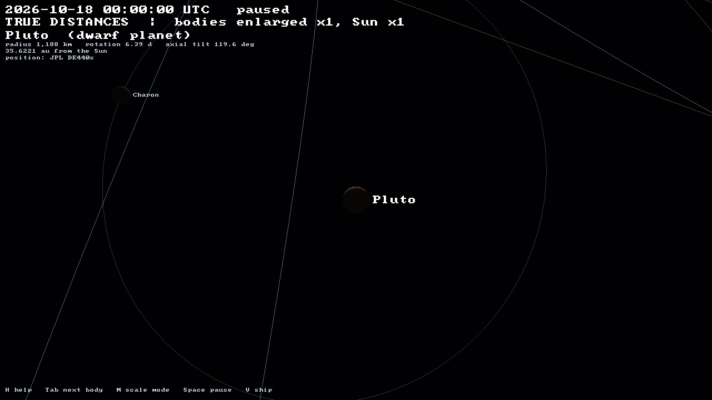
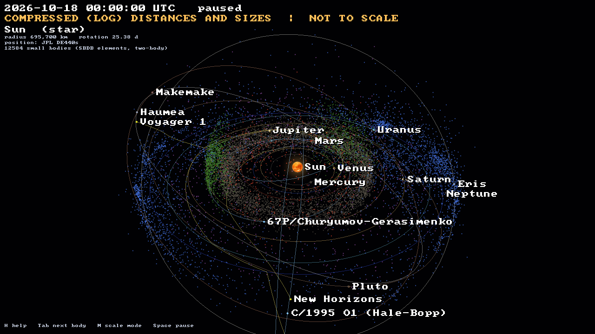

# orrery

The whole solar system from real JPL data, drawn with
[Strata](https://github.com/Preponderous-Software/strata):

- the Sun, the 8 planets and 5 dwarf planets.
- 25 moons: every moon with a mean radius of 100 km or more, plus Phobos and Deimos.
- Saturn's main rings at their measured radii.
- 12,584 asteroids, Jupiter trojans, centaurs and trans-Neptunian objects.
- three comets: Halley, Hale-Bopp and 67P.
- Voyager 1, Voyager 2 and New Horizons.

Bodies are placed from JPL ephemerides at any instant from 1850 to 2149.

<p align="center">
  
</p>

*2026 at **true distances**, with bodies enlarged ×500 and the Sun ×20 so they
can be seen. Each frame is 8 days. It was rendered headless by the real app:
`tools/make_media.py`.*

| Saturn, 2032 (true scale, ×1) | Jupiter and the Galilean moons (true scale, ×1) |
|---|---|
|  |  |
| **Pluto and Charon** (true scale, ×1) | **Everything, COMPRESSED (log) distances: NOT TO SCALE** |
|  |  |

## Scale: what you are looking at

The real solar system cannot be shown at one scale. At true scale, Earth is
1/23,000 of its distance from the Sun, so at any zoom that shows several
orbits every planet is far smaller than a pixel. The orrery has two modes, and
the second line of the on-screen text always says which one is showing.

- **TRUE DISTANCES** (default): every position is the real one. Body radii are multiplied by a factor *k*, shown on screen as "bodies enlarged ×*k*, Sun ×min(*k*, 20)". The Sun is capped so it does not swallow Mercury.
  - Cycle *k* through 1, 10, 100, 500 and 2,000 with `[` and `]`.
  - At *k* = 1 everything is exactly to scale, and each body stays findable as a marker a few pixels wide.
  - Moons keep their true distances. At large *k* a moon can sit inside its enlarged planet: at ×500 the Moon is inside Earth. Use ×1 or ×10 to look at moon systems.
- **COMPRESSED (LOG) DISTANCES AND SIZES: NOT TO SCALE** (key `M`): every direction is kept, but distances and sizes are compressed.
  - Distance from the Sun becomes `5 au × log10(1 + r / 0.3 au)`.
  - Radii become proportional to √radius.
  - A moon at distance *d* from a planet of radius *R* is drawn at *R′*(1 + 2 log₁₀(*d*/*R*)), where *R′* is the planet's drawn radius.
  - Order is preserved: whatever is farther is drawn farther. The mode is for seeing the Kuiper belt and Mercury in one picture, never for judging distances.

## Building and running

You need CMake 3.24 or newer, a C++17 compiler and OpenGL 4.5. Mesa's
llvmpipe is enough, so no GPU is needed. On Linux you also need the X11
development headers that SDL3 builds against (`libx11-dev libxext-dev
libxrandr-dev libxcursor-dev libxi-dev libxfixes-dev libxss-dev`). CMake
fetches Strata at the commit in [`strata.ref`](strata.ref).

The JPL data is not in the repository. On a fresh clone, download it from
JPL and build the catalogue once before anything else. This needs
[uv](https://docs.astral.sh/uv/) and the network; the scripts use only the
Python standard library.

```sh
uv run --python 3.12 tools/fetch_data.py all       # NAIF kernels (32 MB, SHA-256 checked) + ~66 JPL API requests, ~3 min
uv run --python 3.12 tools/build_catalog.py        # data/catalog/ for the app, tests/data/ for the tests
```

The download is rate limited and cached in `data/raw/`, so running it again
only fetches what is missing or whose query changed (`--refresh` fetches it
all again). `data/catalog/manifest.json` records what each build was made
from: every query, when it was fetched and the SHA-256 of each response.
[DATA_SOURCES.md](DATA_SOURCES.md) explains the pipeline and credits the
sources. Then build and run:

```sh
cmake -S . -B build -DCMAKE_BUILD_TYPE=Release
cmake --build build -j4
ctest --test-dir build --output-on-failure
./build/orrery                                      # a window at the current date and time
```

```sh
./build/orrery --date 1986-02-09 --focus Halley --enlarge 1                 # Halley at perihelion
./build/orrery --focus Saturn --enlarge 1 --distance-au 0.004              # Saturn's rings up close
./build/orrery --mode compressed --distance-au 30 --pitch 70              # the Kuiper belt from above
./build/orrery --headless --date 2026-10-18 --screenshot out.png          # one frame, no window
./build/orrery --headless --frames out/ --count 120 --step 3              # frames for a video
./build/orrery --date 2026-10-18 --export-usda solar-system.usda           # an OpenUSD layer
```

Headless rendering uses an EGL surfaceless context, so it needs no X server.
On a machine with no GPU, set `LIBGL_ALWAYS_SOFTWARE=1 GALLIUM_DRIVER=llvmpipe`.
`orrery --help` lists every option.

## Controls

| Key | Action |
|---|---|
| `Space` | play / pause |
| `,` / `.` | slower / faster, from −1 yr/s through real time to +1 yr/s (negative runs backwards) |
| `N` | now, at real time |
| `J` | jump to a date: type `YYYY-MM-DD` or `YYYY-MM-DDTHH:MM` (UTC), then `Enter` |
| `Tab` / `Shift+Tab` | focus the next / previous body (every named body in turn) |
| `0`–`9` | Sun, Mercury … Neptune, Pluto |
| `Home` | the Sun |
| left-drag | orbit the focused body |
| wheel, `PgUp` / `PgDn` | zoom |
| `F` | free flight: `W A S D` to move, `Q` / `E` down / up, drag to look; `F` again to return to orbit |
| `M` | TRUE / COMPRESSED scale |
| `[` / `]` | body enlargement in TRUE mode |
| `O` `L` `B` `X` | orbits, labels, small bodies, spin axes |
| `P` | screenshot (`orrery-NNN.png`) |
| `U` | export the current instant as `orrery.usda` |
| `H` | help |
| `Esc` | quit |

The text at the top left shows the following:

- the date and the time rate.
- the scale mode.
- facts about the focused body: radius, rotation period, axial tilt (from the IAU pole and the current orbit), distance from the Sun and from its parent, and where its position comes from.
- a warning when a body is outside its data, either extrapolated or with no trajectory at that date.

## What is drawn, and from what

| Class | Count | Position source |
|---|---|---|
| Sun, 8 planets, Pluto | 10 | JPL **DE440s** (read directly from the SPK file). Mars to Pluto come from their system barycentres, moved to the planet's centre by subtracting the catalogued moons' GM-weighted offsets |
| The Moon | 1 | DE440s |
| Moons with radius ≥ 100 km, plus Phobos and Deimos | 24 | JPL **Horizons** osculating elements relative to the planet's centre, every 30 days for 1980–2070, interpolated (below) |
| Ceres, Eris, Haumea, Makemake | 4 | Horizons heliocentric elements, every 30 days for 1850–2150, interpolated |
| Comets: 1P/Halley, C/1995 O1 (Hale-Bopp), 67P | 3 | Horizons heliocentric elements, every 60 days for 1850–2150, interpolated |
| Voyager 1, Voyager 2, New Horizons | 3 | Horizons state vectors every 10 days, cubic Hermite interpolation; trajectory drawn up to the current date |
| Main-belt asteroids (numbered, H < 13) | 6,061 | JPL **SBDB** elements at one epoch, propagated two-body (Kepler) |
| Jupiter trojans (numbered, H < 13) | 1,558 | SBDB, two-body |
| Near-Earth asteroids (numbered, H < 17) | 436 | SBDB, two-body |
| Centaurs (orbit condition code ≤ 5) | 671 | SBDB, two-body |
| Trans-Neptunian objects: Kuiper belt and scattered disc (condition code ≤ 5) | 3,858 | SBDB, two-body |
| Saturn's D, C, B, A and F rings; Uranus's ε ring | 6 | NSSDCA ring radii, in the equatorial plane given by the IAU pole |

Further details:

- **Radii, poles and rotation periods** are the IAU WGCCRE 2015 values from NAIF's `pck00011.tpc`. Bodies are drawn as equal-volume spheres. The radii of Eris, Haumea and Makemake come from stellar-occultation papers.
- **Orbits** are drawn as the current osculating ellipse of each planet, dwarf planet and comet. The focused planet's moons get their ellipses too.
- **Lighting:** the Sun is the only light, a point light at its position. Night sides are dark except for a faint ambient term.
- **Interpolating element tables:** between two samples, *a*, *e* and *i* are linear, the node and periapsis follow the shorter arc, and the mean longitude is unwrapped by the revolution count the first sample's mean motion predicts. Positions are therefore exact at every sample and follow the real mean motion in between. A single osculating set would drift by tens of degrees a month for Phobos.

Every source, licence and citation is in [DATA_SOURCES.md](DATA_SOURCES.md).

## Accuracy

`tests/test_ephemeris.cpp` compares the orrery with reference state vectors
fetched from JPL Horizons at build time. Every check has a fixed tolerance,
so it holds for any later fetch, even as JPL updates its orbit solutions.
The values below are from a build with data fetched on 2026-10-18.

| Check | Epochs | Worst error | Tolerance |
|---|---|---|---|
| Sun, Mercury, Venus, Earth, Mars–Pluto barycentres (our SPK reader on DE440s vs Horizons on DE441), SSB-relative | 1950, 2000, 2026, 2100 | < 0.001 km | 2–50 km |
| Moon, geocentric | same | 0.010 km | 1 km |
| Jupiter's centre (barycentre minus the Galilean moons' pull) | 2003, 2026, 2049 | 0.09 km | 25 km |
| Pluto's centre (barycentre minus Charon's pull) | same | 4.8 km | 25 km |
| Phobos / Triton / Charon (interpolated element tables) | same | 9.5 / 17 / 0.02 km | 15 / 30 / 15 km |
| Io / Titan / Hyperion | same | 644 / 185 / 2,936 km | 1,000 / 300 / 5,000 km |
| Ceres / Eris (heliocentric tables) | same | 1,611 / 318 km | 5,000 km |
| 1P/Halley | 1986 perihelion, 2026, 2061 perihelion | 6,558 km | 20,000 km |
| Voyager 1 (Hermite on 10-day vectors) | 1989, 2012, 2026 | 0.05 km | 50 km |
| Vesta, two-body from SBDB elements: at the epoch / +1 yr / −10 yr | 2026-06-09 ± | 0.2 / 42,246 / 1,351,693 km | 1e3 / 1e5 / 3e6 km |

For scale:

- 644 km at Io is 0.09° of its orbit.
- 6,558 km at Halley's perihelion is 0.00004 au.
- The Vesta figures show the main limit of the small-body sample. Two-body orbits from a 2026 epoch drift by about 0.0003 au a year, and by about 0.01 au after a decade. That is invisible at belt scale, but these are not precise positions far from 2026.

The other tests:

- `test_kepler` covers Kepler's equation (elliptic and hyperbolic) to 1e-12, circular and eccentric orbits, the state ↔ elements round trip, and table interpolation that is exact against a synthetic Phobos-like orbit.
- `test_time` covers Julian Dates, leap seconds and TDB − UTC, and ISO parsing.
- `test_scale` checks that TRUE mode leaves positions untouched and multiplies radii by exactly the stated factor, and that COMPRESSED mode keeps direction and order. It also checks unit conversions (au, obliquity).
- `render_smoke` renders three views headless and checks that each frame is lit, with the expected numbers of spheres, points, orbit vertices and labels.
- CI also opens the exported USD layer with OpenUSD (`tests/check_usda.py`).

## Engine features this needed

Four generic features were added to Strata for this project in
[Strata #11](https://github.com/Preponderous-Software/strata/pull/11) (ABI 1.5):

- unlit **lines** (orbits).
- **points** with a pixel and/or world size. These draw 12,584 small bodies in one call, the Sun's disc and glow, and the markers that keep sub-pixel bodies visible.
- screen-space **text** in a public-domain 8×8 font (labels and HUD).
- a **space lighting** mode lit only by point lights.

The rings use Strata's static meshes (ABI 1.4).

**Precision** is handled in the orrery, not in Strata:

- Every position is a double in km.
- Each frame subtracts the camera position before converting to float (a floating origin), so floats only ever hold distances relative to the eye.
- The near plane follows the closest surface. Lines and points use depth clamp, so the far plane never cuts them.

## OpenUSD

`--export-usda` (or `U` in the window) writes the current instant as a USD
text layer:

- one `Sphere` per body, at true position and radius, in km in the J2000 ecliptic frame with `upAxis = "Z"`.
- one `Points` prim per small-body group.
- `customData` on each prim naming its data sources.

The layer is plain text written by the app. Strata's optional `modules/usd`
was not used because it needs a full OpenUSD build, which this program does
not otherwise need. The layer is meant for the other USD tools, which can open
it directly; CI checks it with OpenUSD (`usd-core`).

## Known gaps

- **No textures.**
  - Strata has no texture path yet, so bodies are plain colours.
  - The colours are hand-picked tints, not measured data.
  - No rotation is visible, although rotation periods and poles are known and shown in the HUD; `X` draws spin axes.
- **Spheres only.** Bodies are equal-volume spheres. Jupiter's and Saturn's oblateness and Haumea's elongated shape are not drawn, because Strata's primitives scale along the world axes and cannot be tilted to a pole.
- **Missing moons.** Moons of dwarf planets other than Charon (Dysnomia, Hiʻiaka, Namaka, MK2) are not included: Horizons has no ephemeris for them. Moons smaller than 100 km (Amalthea, Janus, Larissa and many more) are left out by the size cutoff.
- **Limited time ranges.**
  - The time range is DE440s's coverage, 1849-12-26 to 2150-01-22.
  - Moon tables cover 1980–2070. Outside that span a moon is propagated two-body from the nearest sample and the HUD says "extrapolated".
  - New Horizons' trajectory file ends in 2050.
- **Geometric positions.** There is no light-time correction or aberration, so these are where bodies are, not where they appear from Earth. There are no eclipses and no shadows: Strata's point-light shadows are not used.
- **Two-body small bodies.** Small bodies are propagated two-body from a single 2026 epoch (see Accuracy).
- **UTC before 1972** uses TAI − UTC = 10 s, which is an approximation.
- **Plain labels.** Labels are skipped where they would overlap, and the font is ASCII only.
- **Depth precision.** A deep near-to-far range is unavoidable. Far spheres can fall beyond the far plane, but their point markers still show them.

## Licence

MIT; see [LICENSE](LICENSE). The data is not the code's: see
[DATA_SOURCES.md](DATA_SOURCES.md) for its terms.
